# ProfessorDM Architecture Diagrams

All diagrams are rendered by GitHub's built-in Mermaid support.
Source `.mmd` files live alongside this README for editing.

---

## 00 — Master Architecture

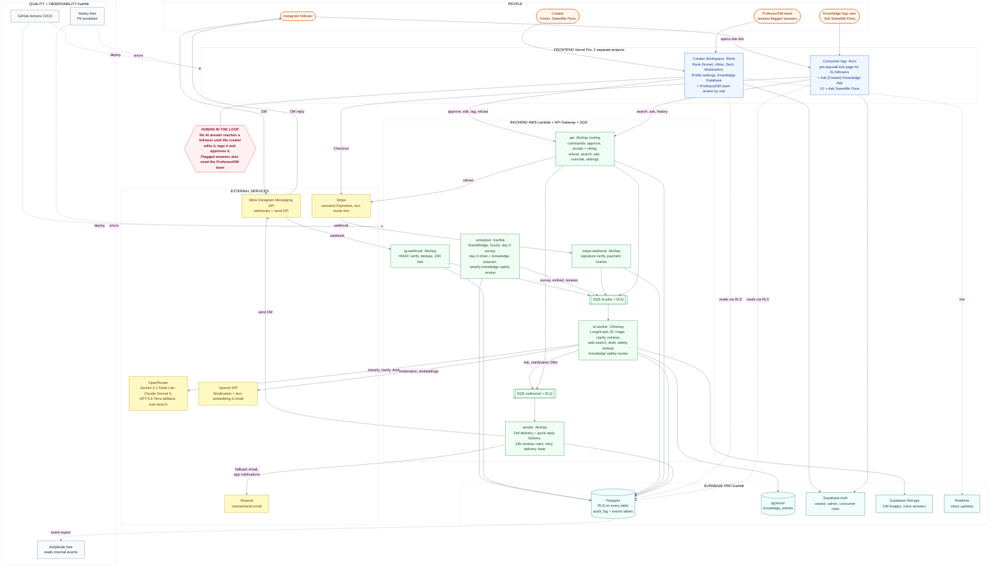

---

## 01 — Tech Stack Overview

```mermaid
%%{init: {'theme':'base','themeVariables':{'primaryColor':'#FEFCE8','primaryTextColor':'#1C1917','primaryBorderColor':'#CA8A04','lineColor':'#64748B','background':'#FFFFFF'}}}%%
flowchart LR
    %% Source of truth: ProfessorDM Technology Selection Matrix, Sep 19 2026.
    %% Items marked TEAM are implementation choices the matrix leaves open.

    subgraph M1["1 SOURCE CONTROL + CI/CD  $0"]
        A1["GitHub Free<br/>ProfessorDM org, company email owner"]
        A2["GitHub Actions"]
    end

    subgraph M2["2 FRONTEND HOSTING  $20"]
        B1["Vercel Pro<br/>Creator Workspace project<br/>Consumer App project"]
        B2["TEAM: Next.js + TypeScript"]
    end

    subgraph M3["3 BACKEND API + WEBHOOKS  $0 dev"]
        C1["AWS Lambda + API Gateway"]
        C2["TEAM: Node 22 LTS + TypeScript,<br/>AWS SAM for IaC"]
        C3["NEW: EventBridge Scheduler<br/>survey, hold close, payouts,<br/>knowledge review. About $0"]
    end

    subgraph M46["4-7 DATA PLATFORM  $25"]
        D1["Supabase Pro<br/>Postgres + Auth + RLS<br/>logins: email, Google, Apple, Microsoft"]
        D2["Supabase Storage<br/>images, signed URLs"]
        D3["pgvector<br/>embedding in same row as metadata"]
        D4["AWS SQS<br/>DLQ + retries"]
    end

    subgraph M89["8-9 AI  $0-5 dev"]
        E1["OpenRouter gateway"]
        E2["Gemini 3.1 Flash-Lite<br/>classification + clarification"]
        E3["Claude Sonnet 5<br/>grounded drafting"]
        E4["GPT-5.6 Terra<br/>fallback"]
        E5["OpenAI text-embedding-3-small<br/>benchmark vs 3-large first"]
        E6["TEAM: LangGraph JS orchestration"]
        E7["NEW: web search to fill gaps<br/>Kristin, Sep 23. Tool in ADR,<br/>e.g. OpenRouter web plugin"]
    end

    subgraph M10["10 SAFETY  $0"]
        F1["OpenAI Moderation API"]
        F2["Deterministic domain rules<br/>blocked list signed off by Kristin"]
        F3["Model-based policy classifier<br/>gray areas"]
    end

    subgraph M1112["11-12 INTEGRATIONS"]
        G1["Direct Meta Instagram Messaging API<br/>no wrapper, dev IG account first"]
        G2["Stripe test mode for V1 dev<br/>standard Payments for beta<br/>no Connect, 3-day hold in DB<br/>+ subscriptions ($10/mo default)"]
    end

    subgraph M1315["13-15 EMAIL + OBSERVABILITY + ANALYTICS  $0"]
        H1["Resend<br/>auth, resets, answer notices"]
        H2["Sentry free<br/>PII scrubbed"]
        H3["Supabase logs"]
        H4["Postgres audit_log table"]
        H5["Amplitude free<br/>+ internal events table"]
    end

    subgraph TEST["TEAM: TESTING"]
        T1["Vitest unit"]
        T2["Playwright E2E"]
        T3["eval harness<br/>classification, retrieval, safety"]
    end

    M2 --> M3
    M3 --> M46
    M3 --> M89
    M89 --> M10
    M3 --> M1112
    M3 --> M1315
    M1 -.-> M2
    M1 -.-> M3
    TEST -.-> M1

    BUD["BUDGET<br/>Dev about $45/mo, Beta about $85-130/mo<br/>Target under $150 dev, under $500 beta"]

    style M1 fill:#F8FAFC,stroke:#64748B,color:#1E293B
    style M2 fill:#EFF6FF,stroke:#2563EB,color:#1E3A8A
    style M3 fill:#F0FDF4,stroke:#15803D,color:#14532D
    style M46 fill:#F0FDFA,stroke:#0F766E,color:#134E4A
    style M89 fill:#FAF5FF,stroke:#7C3AED,color:#4C1D95
    style M10 fill:#FFF1F2,stroke:#E11D48,color:#881337
    style M1112 fill:#FEF9C3,stroke:#CA8A04,color:#713F12
    style M1315 fill:#FFF7ED,stroke:#EA580C,color:#7C2D12
    style TEST fill:#F8FAFC,stroke:#94A3B8,color:#334155,stroke-dasharray:4
    style BUD fill:#ECFDF5,stroke:#059669,color:#064E3B
```

---

## 02 — Instagram Golden Path

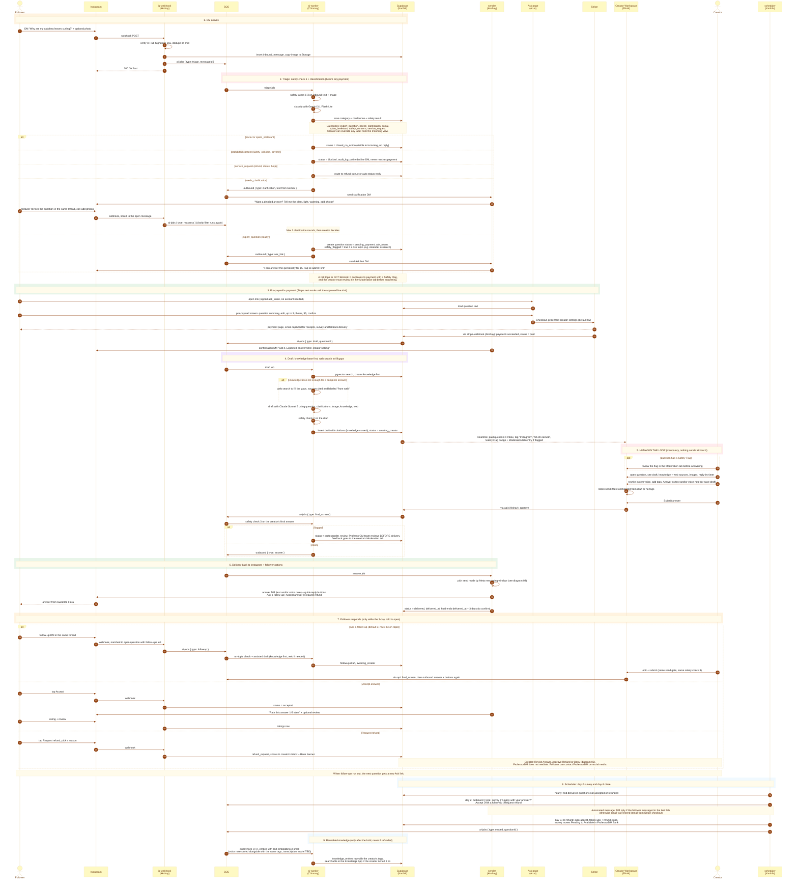

---

## 02b — Knowledge App Flow

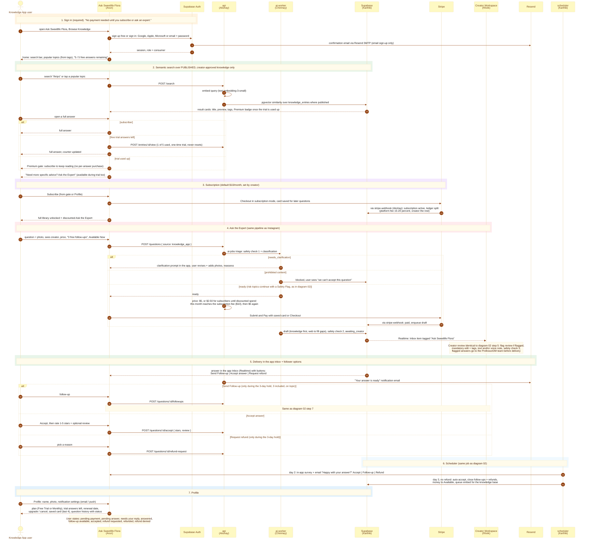

---

## 03 — Backend & Instagram (Akshay)

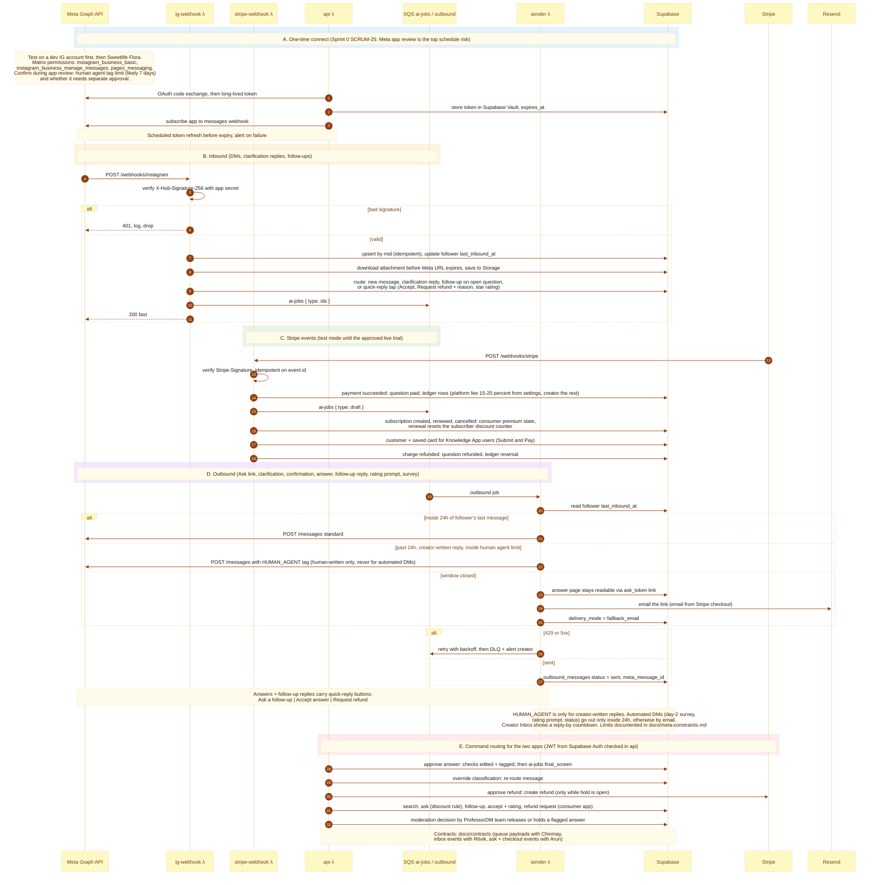

---

## 04 — AI & Knowledge Worker (Chinmay)

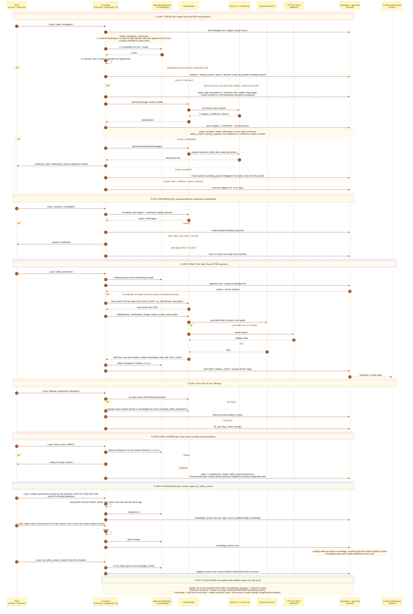

---

## 05 — Creator Workspace & Transactions (Ritvik)

```mermaid
%%{init: {'theme':'base','themeVariables':{'actorBkg':'#FEF9C3','actorTextColor':'#713F12','signalColor':'#92400E','signalTextColor':'#1C1917','noteBkgColor':'#FFFBEB','noteTextColor':'#451A03'}}}%%
sequenceDiagram
    autonumber
    %% OWNER: Ritvik, Creator Application + Transaction Workflow Lead.
    %% Creator Workspace = the "control tower". Vercel project 1.
    %% Reads via Supabase RLS + Realtime. Every write goes through api (Akshay).
    actor CR as Creator (Kristin)
    actor AD as ProfessorDM team
    participant CW as Creator Workspace<br/>(Ritvik)
    participant API as api<br/>(Akshay)
    participant DB as Supabase<br/>(Karthik)
    participant AI as ai-worker<br/>(Chinmay)
    participant STR as Stripe

    rect rgb(255, 243, 224)
    Note over CR,DB: FLOW 1  Sign in, ProfessorDM Bank as home, Incoming Messages
    end
    CR->>CW: sign in (Supabase Auth, role creator, invite only in V1)
    CW-->>CR: lands on ProfessorDM Bank (home page), refund banner if any
    CW->>DB: read inbound messages with AI label + confidence (RLS)
    CW-->>CR: Incoming: Expert Question, Needs Clarification, Social, Spam, Safety, Service
    CR->>CW: override a wrong label (e.g. Social to Expert Question)
    CW->>API: POST /messages/:id/override
    API->>DB: new category, audit_log, re-route (Ask link queued if Expert)

    rect rgb(232, 245, 233)
    Note over CR,DB: FLOW 2  Inbox tab: paid questions from every channel in one queue
    end
    DB-->>CW: Realtime: new paid question, AI draft ready
    CW-->>CR: card: source tag Instagram or Ask Sweetlife Flora, $4.00 earned,<br/>AI draft ready, awaiting answer / in progress, follow-ups left, reply-by timer,<br/>Safety Flag badge if flagged
    Note over CW: Tabs with counts: Inbox | Sent | Moderation. Refund requests pinned at the top of Inbox.

    rect rgb(255, 235, 238)
    Note over CR,AI: FLOW 3  Answer (HUMAN IN THE LOOP, mandatory)
    end
    opt question has a Safety Flag
        CR->>CW: review the flag in the Moderation tab first, then the question unlocks
        CW->>API: POST /moderation/:flagId/creator-review
    end
    CR->>CW: open question
    CW-->>CR: question, photos, clarification history, classification, safety flags,<br/>AI draft with sources labeled: creator knowledge | web (URL)
    CR->>CW: rewrite in own voice, answer as text and/or voice note (or save draft, or decline)
    CR->>CW: add tags
    CW->>CW: SEND GATE: text changed from draft? at least one tag?
    alt unchanged or no tags
        CW-->>CR: blocking warning: "You are the expert. Make this answer yours."
    else passes
        CR->>CW: Submit answer
        CW->>API: POST /drafts/:id/approve { finalText, voiceNote?, tags }
        API->>API: re-check gate server side (HITL enforced in api, not only UI)
        API->>DB: status approved, edit_distance, audit_log
        API->>AI: ai-jobs final_screen (safety checkpoint 3)
        alt clean
            AI-->>DB: outbound queued, then delivered
            DB-->>CW: Realtime: moves to Sent
        else flagged
            AI-->>DB: professordm_review, shows in Moderation tab as "with ProfessorDM team"
        end
    end
    alt Decline
        CR->>CW: Decline with reason
        CW->>API: POST /questions/:id/decline
        API->>STR: full refund
        API->>DB: status declined_refunded, ledger reversal
    end

    rect rgb(243, 232, 255)
    Note over CR,AI: FLOW 4  Sent tab: follow-ups, accept, rating
    end
    DB-->>CW: Realtime: follow-up #1 arrived, AI reply draft ready
    CW-->>CR: thread view: 1 of 3 used, off-topic flag if any, 3-day hold reminder
    CR->>CW: edit + Submit (same gate + safety check as FLOW 3)
    CW->>API: POST /followups/:id/approve
    API->>DB: followups_used + 1, final_screen, outbound
    Note over CW: Follow-ups only while the 3-day hold is open.<br/>Sent card shows: answer sent, answer accepted, stars + review, funds released

    rect rgb(255, 243, 224)
    Note over CR,STR: FLOW 5  Refund requests (only inside the 3-day hold)
    end
    DB-->>CW: Realtime: refund requested, reason, sent answer (also a banner in the Bank)
    alt Revisit Answer (always try this first, per the guide)
        CR->>CW: Revisit, edit answer, send again through FLOW 3 gate, payment kept
    else Approve Refund
        CR->>CW: Approve
        CW->>API: POST /refunds/:id/approve
        API->>STR: create refund (from the held money)
        STR-->>DB: charge.refunded via stripe-webhook: refunded, ledger reversal
    else Deny
        CR->>CW: Deny (e.g. follow-ups not used, or revised answer already sent)
        CW->>API: POST /refunds/:id/deny { note }
        API->>DB: refund_denied, audit_log, follower notified
    end
    Note over CR,STR: ProfessorDM does not mediate. The follower can contact ProfessorDM on social media.<br/>After the 3-day hold, refund requests close.

    rect rgb(255, 235, 238)
    Note over CR,AD: FLOW 6  Moderation tab (two kinds of flagged items)
    end
    CW-->>CR: 1. flagged follower QUESTIONS: creator reviews before she can answer
    CW-->>CR: 2. flagged creator ANSWERS: sent to the ProfessorDM team before delivery
    AD->>CW: admin view (role admin): review flagged answer, approve or send back
    CW->>API: POST /moderation/:flagId/decision { decision, feedback }
    API->>DB: decision + reviewer + time in audit_log.<br/>Approved: delivery queued. Sent back: feedback shown in creator's Moderation tab
    Note over CW,DB: Also lands here: knowledge entries flagged by the weekly AI safety review

    rect rgb(232, 245, 233)
    Note over CR,DB: FLOW 7  ProfessorDM Bank (payout STATUS only in V1)
    end
    CR->>CW: open ProfessorDM Bank
    CW->>DB: ledger + questions
    DB-->>CW: tiles: Available Now | Pending (3-day hold) | Total Balance, plus Lifetime
    CW-->>CR: transaction list filterable by status: unanswered, in progress<br/>("available in 3 days"), completed, refund requested
    CR->>CW: Withdraw Available Balance (only Available Now)
    CW->>API: POST /payouts
    API->>DB: payout requested. ProfessorDM pays by manual transfer, admin marks paid
    Note over CW,DB: Payout mode (creator setting): Automatic = paid every Friday after the hold.<br/>On Demand = held until requested, auto-paid after 30 days (scheduler).<br/>V1: no Stripe Connect, money in ProfessorDM's Stripe, split tracked in Postgres.

    rect rgb(227, 242, 253)
    Note over CR,AI: FLOW 8  Edit Profile + Knowledge Database
    end
    CR->>CW: Edit Profile: photo, bio, question price, follow-ups included,<br/>payout method, payout mode, notification preferences, expected answer time,<br/>Knowledge Database on/off, subscription price, subscriber discount
    CW->>API: PUT /creator/settings
    CR->>CW: Knowledge Database (creator only): edit past answers, add/edit/remove tags,<br/>add new facts by hand, unpublish
    CW->>API: POST /knowledge
    API->>AI: ai-jobs ingest or embed
```

---

## 06 — Consumer App (Arun)

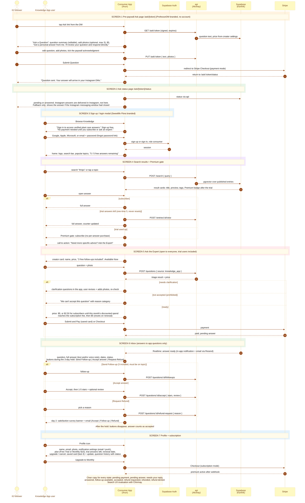

---

## 07 — Cloud & Security (Karthik)

```mermaid
%%{init: {'theme':'base','themeVariables':{'primaryColor':'#FEFCE8','primaryTextColor':'#1C1917','primaryBorderColor':'#CA8A04','lineColor':'#64748B','background':'#FFFFFF'}}}%%
flowchart TB
    %% OWNER: Karthik, Cloud, Data, Security + Quality Lead, and Technical Architecture Coordinator.
    %% Coordinates architecture, does not assign day-to-day work (roles doc).

    subgraph ARCH["ARCHITECTURE COORDINATION"]
        A1["this diagram pack + docs/BASELINE.md"]
        A2["interface contracts in packages/contracts<br/>queue payloads, api routes, status enums"]
        A3["ADRs in docs/adr  any change touching<br/>another workstream gets an ADR first"]
        A4["weekly cross-lead integration check"]
    end

    subgraph ENV["ENVIRONMENTS  see diagram 10"]
        E1["local: Supabase CLI + Stripe test"]
        E2["staging: Supabase staging project, AWS staging stack,<br/>Vercel preview, Meta dev IG test account"]
        E3["production beta: created at Beta RC Mar 2027,<br/>Sweetlife Flora, Stripe live only if approved"]
        E4["scheduler: EventBridge hourly job,<br/>same in staging + prod"]
    end

    subgraph DATA["DATA ARCHITECTURE"]
        D1["schema + SQL migrations  supabase/migrations"]
        D2["RLS on every table, deny by default"]
        D3["pgvector index tuning with Chinmay"]
        D4["Supabase daily backups, restore drill before beta"]
    end

    subgraph SEC["SECURITY + PRIVACY"]
        S1["roles: creator, admin (ProfessorDM team), consumer<br/>service key only inside Lambdas<br/>consumer logins: email, Google, Apple, Microsoft"]
        S2["secrets: Vercel env vars, AWS SSM SecureString,<br/>GitHub OIDC to AWS. No secrets in code, rotate if leaked"]
        S3["webhook signatures: Meta HMAC + Stripe"]
        S4["Meta token in Supabase Vault"]
        S5["private Storage buckets, short signed URLs"]
        S6["PII: Sentry scrubbing before real DMs,<br/>anonymize before knowledge publish"]
        S7["retention: see BASELINE.md section 5"]
        S8["accounts owned by ProfessorDM email, never student or ASU email"]
    end

    subgraph OBS["OBSERVABILITY"]
        O1["Sentry free: apps + Lambdas"]
        O2["Supabase logs: DB, auth, storage"]
        O3["audit_log: state changes, moderation,<br/>creator actions, append only"]
        O4["events table feeds Amplitude"]
        O5["DLQ depth + failed delivery alerts"]
    end

    subgraph QA["TEST STRATEGY + RELEASE GATES"]
        Q1["each lead: unit tests in own workstream  Vitest"]
        Q2["Karthik: Playwright E2E on golden paths 02 + 02b"]
        Q3["contract tests on queue payloads"]
        Q4["AI eval gates with Chinmay: no prompt or model<br/>change merges if eval drops below baseline"]
        Q5["milestone gate: Kristin demo sign-off"]
        Q6["pre-beta: security, privacy, performance,<br/>resilience review  Mar 5 2027"]
    end

    subgraph GR["AI GUARDRAILS  co-owned with Chinmay"]
        G1["blocked category list, Kristin signs off"]
        G2["3 checkpoints: inbound, draft, final<br/>+ weekly knowledge base review"]
        G4["2 tiers: prohibited = blocked,<br/>risk topic = Safety Flag + creator review"]
        G5["flagged creator answers need<br/>ProfessorDM team approval"]
        G6["web search results: cited, labeled,<br/>safety-checked, never auto-sent"]
        G3["HITL enforced in api, not only in UI"]
    end

    ARCH --> ENV --> DATA --> SEC --> OBS --> QA
    GR -.-> QA
    ARCH -.-> GR

    style ARCH fill:#FFFBEB,stroke:#D97706,color:#451A03
    style ENV fill:#F0FDF4,stroke:#15803D,color:#14532D
    style DATA fill:#F0FDFA,stroke:#0F766E,color:#134E4A
    style SEC fill:#FFF1F2,stroke:#E11D48,color:#881337
    style OBS fill:#FEF9C3,stroke:#CA8A04,color:#713F12
    style QA fill:#EFF6FF,stroke:#2563EB,color:#1E3A8A
    style GR fill:#FAF5FF,stroke:#7C3AED,color:#4C1D95
```

---

## 08 — Process & Beta (Maximo)

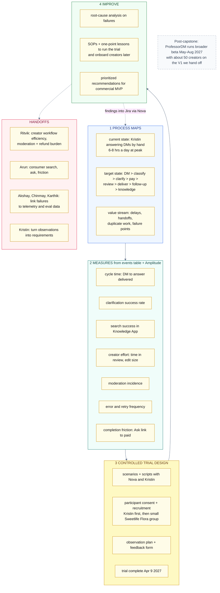

---

## 09 — Delivery & Integration (Nova)

```mermaid
%%{init: {'theme':'base','themeVariables':{'primaryColor':'#FEFCE8','primaryTextColor':'#1C1917','primaryBorderColor':'#CA8A04','lineColor':'#64748B','background':'#FFFFFF'}}}%%
flowchart TB
    %% OWNER: Nova, Project Manager + Delivery Integration Lead.
    %% Owns WHEN and WHO. Technical leads own HOW. Kristin owns WHAT and final acceptance.
    %% Dates = sponsor milestone framework (Roles doc section 6). ASU deadlines take precedence.

    subgraph FALL["FALL 2026  Architecture, Connectivity, Core Intelligence  (classes end Dec 4)"]
        direction LR
        F1["Sep 18<br/>Team + project baseline<br/>Nova + all"]
        F2["Sep 25<br/>V1 requirements +<br/>architecture baseline<br/>Karthik + leads"]
        F3["Oct 16<br/>Platform + Instagram demo<br/>webhook, in/out test DMs,<br/>app shells<br/>Akshay / Karthik"]
        F4["Oct 30<br/>AI + Knowledge slice<br/>classify, clarify, retrieval,<br/>draft, initial safety<br/>Chinmay + team"]
        F5["Nov 13<br/>End-to-end Alpha 0.1<br/>IG question to inbox, draft,<br/>review, answer back to IG<br/>All technical"]
        F6["Dec 1<br/>Semester 1 release<br/>stable alpha, test evidence,<br/>Spring backlog<br/>Nova + all"]
        F1 --> F2 --> F3 --> F4 --> F5 --> F6
    end

    subgraph SPR["SPRING 2027  Full Workflow, Consumer Experience, Beta Readiness  (classes end Apr 30)"]
        direction LR
        P1["Jan 22<br/>Spring re-baseline<br/>Nova + leads"]
        P2["Feb 12<br/>Feature-complete Alpha 0.5<br/>Stripe test flow, follow-ups,<br/>moderation, search<br/>All technical"]
        P3["Mar 5<br/>Internal Beta 0.8<br/>hardening, regression,<br/>trial scripts<br/>Karthik / Maximo"]
        P4["Mar 26<br/>Beta RC 1.0<br/>acceptance tests pass,<br/>prod env ready<br/>Nova + all"]
        P5["Apr 9<br/>Controlled Sweetlife<br/>Flora trial done<br/>Maximo / Nova"]
        P6["Apr 23<br/>Critical fixes +<br/>beta findings<br/>All"]
        P7["Apr 30<br/>Final handoff V1 MVP<br/>Nova + all"]
        P1 --> P2 --> P3 --> P4 --> P5 --> P6 --> P7
    end

    F6 --> P1

    subgraph PM["NOVA RUNS"]
        direction LR
        N1["integrated master schedule<br/>2-week sprints, sprint ends<br/>aligned to milestone dates"]
        N2["Jira: epics per workstream,<br/>tickets tagged with diagram flow"]
        N3["risk, issue, decision,<br/>dependency, action logs"]
        N4["sponsor status: decisions,<br/>risks, demos only"]
        N5["change control: clarification<br/>vs scope change"]
        N6["beta readiness with Maximo"]
        N7["final handoff package"]
    end

    subgraph RISK["TOP RISKS ON THE REGISTER NOW"]
        R1["Meta app review time<br/>SCRUM-25, blocks Oct 16"]
        R2["24h messaging window<br/>vs creator answer time"]
        R3["Stripe live trial approval"]
        R4["account access runs through Kristin<br/>Vercel codes, JM on Instagram"]
    end

    PM -.-> FALL
    PM -.-> SPR
    RISK -.-> PM

    style FALL fill:#EFF6FF,stroke:#2563EB,color:#1E3A8A
    style SPR fill:#F0FDF4,stroke:#15803D,color:#14532D
    style PM fill:#FFFBEB,stroke:#D97706,color:#451A03
    style RISK fill:#FFF1F2,stroke:#E11D48,color:#881337
```

---

## 10 — Deployment Environments

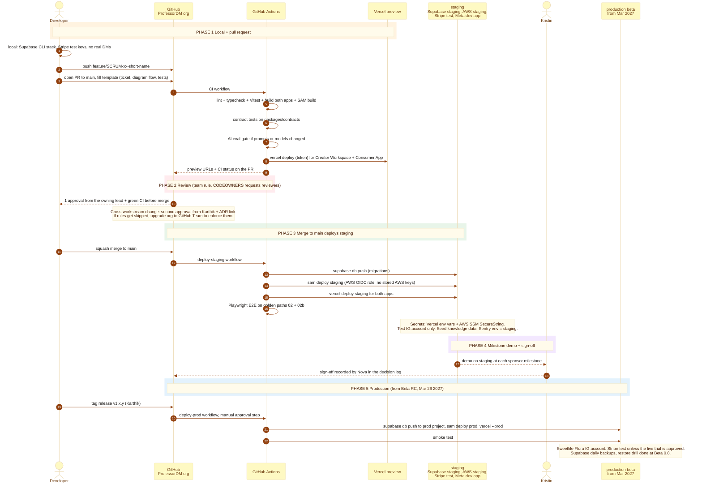

---

## 11 — Data Model ERD

```mermaid
%%{init: {'theme':'base'}}%%
erDiagram
    %% OWNER: Karthik (schema, RLS) with Chinmay (knowledge), Ritvik (workflow), Akshay (messages).
    %% Supabase Postgres + pgvector. RLS on every table. Money in cents, CAD or USD per Stripe account.

    profiles ||--o| creators : "is"
    profiles ||--o| consumers : "is"
    creators ||--|| creator_settings : has
    creators ||--o| ig_accounts : connects
    creators ||--o{ ig_followers : "DMs from"
    creators ||--o{ questions : receives
    creators ||--o{ knowledge_docs : uploads
    creators ||--o{ knowledge_entries : owns
    creators ||--o{ tags : defines
    creators ||--o{ payouts : requests

    ig_followers ||--o{ inbound_messages : sends
    inbound_messages ||--o{ clarification_rounds : has
    inbound_messages ||--o| questions : "becomes"
    ig_followers ||--o{ questions : "asks via IG"
    consumers ||--o{ questions : "asks via app"
    consumers ||--o{ subscriptions : has

    questions ||--o{ drafts : has
    questions ||--o{ followups : has
    questions ||--o{ media : attaches
    questions ||--o{ payments : "paid by"
    questions ||--o{ refund_requests : may_have
    questions ||--o| ratings : "rated by"
    questions ||--o{ question_tags : tagged
    tags ||--o{ question_tags : used_in
    followups ||--o| drafts : "answered by"
    drafts ||--o{ outbound_messages : "delivered as"
    inbound_messages ||--o{ outbound_messages : "replied to by"
    ig_followers ||--o{ outbound_messages : "receives"
    creators ||--o{ outbound_messages : "sends"
    questions ||--o| knowledge_entries : "published as"
    knowledge_docs ||--o{ knowledge_entries : chunked_into

    payments ||--o{ ledger_entries : posts
    subscriptions ||--o{ ledger_entries : posts
    payouts ||--o{ ledger_entries : posts

    profiles {
        uuid id PK "= auth.users.id"
        text role "creator | admin | consumer"
        text display_name
        timestamptz created_at
    }
    creators {
        uuid id PK
        uuid profile_id FK
        text brand_name "Sweetlife Flora"
        text status "setup | active"
    }
    creator_settings {
        uuid creator_id PK
        int question_price_cents "default 500"
        int platform_fee_bps "1500-2000 = 15-20 percent"
        int followups_included "default 3"
        bool knowledge_app_enabled
        int kb_subscription_price_cents "default 1000"
        int free_answer_limit "default 5, one-time trial"
        int subscriber_question_price_cents "default 250"
        text expected_answer_time
        text payout_method
        text payout_mode "automatic weekly Friday | on_demand, auto after 30 days"
    }
    ig_accounts {
        uuid id PK
        uuid creator_id FK
        text ig_user_id UK
        uuid vault_token_id "Supabase Vault"
        timestamptz token_expires_at
        bool human_agent_approved
    }
    ig_followers {
        uuid id PK
        uuid creator_id FK
        text ig_scoped_id UK
        text username
        text email "from Stripe checkout, nullable"
        timestamptz last_inbound_at "24h window"
    }
    consumers {
        uuid id PK
        uuid profile_id FK
        int free_views_used "trial, never resets"
        text auth_provider "email | google | apple | azure"
        text stripe_customer_id "saved card"
    }
    inbound_messages {
        uuid id PK
        uuid follower_id FK
        text mid UK "Meta message id, dedupe"
        text text
        text category "6 categories"
        numeric confidence
        text override_category "creator"
        text status
        text prompt_version
        timestamptz received_at
    }
    clarification_rounds {
        uuid id PK
        uuid message_id FK
        int round "max 2"
        text prompt
        text reply
    }
    questions {
        uuid id PK
        uuid creator_id FK
        text source "instagram | knowledge_app"
        uuid follower_id FK "nullable"
        uuid consumer_id FK "nullable"
        uuid origin_message_id FK "nullable"
        text question_text
        text status "see BASELINE status model"
        bool safety_flagged "risk topic, creator reviews first"
        text ask_token UK "signed link"
        int price_cents
        int followups_included
        int followups_used
        timestamptz paid_at
        timestamptz delivered_at
        timestamptz hold_ends_at "delivered_at + 3 days, to confirm"
        timestamptz survey_sent_at "day 2"
        timestamptz accepted_at "tap or auto at hold end"
    }
    media {
        uuid id PK
        uuid question_id FK
        uuid message_id FK
        text storage_path "private bucket"
        text kind "image | voice_note"
    }
    drafts {
        uuid id PK
        uuid question_id FK
        uuid followup_id FK "nullable"
        text ai_text
        jsonb citations "knowledge ids + web URLs, labeled"
        bool used_web_search
        text model_used
        text prompt_version
        text final_text
        int edit_distance "must be above 0"
        text status
        timestamptz approved_at
    }
    followups {
        uuid id PK
        uuid question_id FK
        int seq
        text text
        bool on_topic
        text status
    }
    tags {
        uuid id PK
        uuid creator_id FK
        text name
    }
    question_tags {
        uuid question_id FK
        uuid tag_id FK
    }
    outbound_messages {
        uuid id PK
        uuid draft_id FK "nullable, null = creator typed it directly"
        text type "ask_link | clarification | confirmation | answer | followup | rating_prompt | survey | decline"
        text delivery_mode "standard | human_agent | fallback_email"
        text meta_message_id
        text status "pending -> sent | failed"
        int attempts
        uuid inbound_message_id FK "nullable, DM this replies after"
        uuid follower_id FK "nullable, recipient = thread"
        text text "nullable, non-blank when direct answer"
        uuid creator_id FK "nullable, sender, used by RLS"
        uuid client_request_id UK "one per Send press, blocks double-click"
        timestamptz created_at "default now()"
    }
    safety_flags {
        uuid id PK
        text target_type "message | draft | final | knowledge_entry"
        uuid target_id
        text checkpoint "1 | 2 | 3"
        text layer "moderation | rules | policy"
        text category
        text status "open | creator_reviewed | approved | sent_back"
        text feedback "ProfessorDM team to creator"
        uuid reviewed_by FK
    }
    knowledge_docs {
        uuid id PK
        uuid creator_id FK
        text title
        text storage_path
    }
    knowledge_entries {
        uuid id PK
        uuid creator_id FK
        uuid doc_id FK "nullable"
        uuid question_id FK "nullable"
        text source "question | doc | manual_fact"
        text content "anonymized"
        uuid voice_media_id FK "nullable"
        text_array tags
        bool published "Knowledge App visible"
        vector embedding "1536, text-embedding-3-small"
    }
    payments {
        uuid id PK
        uuid question_id FK
        text stripe_payment_intent_id UK
        int amount_cents
        int platform_fee_cents
        int creator_share_cents
        text status "succeeded | refunded"
    }
    refund_requests {
        uuid id PK
        uuid question_id FK
        text reason
        text status "pending | approved | denied | revisited"
        uuid decided_by FK
    }
    subscriptions {
        uuid id PK
        uuid consumer_id FK
        text stripe_subscription_id UK
        text status
        timestamptz current_period_end
        int discount_spent_cents "this period, resets on renewal"
    }
    payouts {
        uuid id PK
        uuid creator_id FK
        int amount_cents
        text trigger "manual | weekly_auto | 30_day_auto"
        text status "requested | paid"
        text reference "manual transfer ref"
    }
    ledger_entries {
        uuid id PK
        text entry_type "question_fee | platform_fee | refund | subscription | payout"
        int amount_cents
        uuid payment_id FK
        uuid subscription_id FK
        uuid payout_id FK
        timestamptz created_at "append only"
    }
    ratings {
        uuid id PK
        uuid question_id FK, UK
        int stars "1-5"
        text review "optional"
        timestamptz created_at
    }
    audit_log {
        uuid id PK
        uuid actor_id
        text action
        text entity
        uuid entity_id
        jsonb before_after
        timestamptz created_at "append only"
    }
    events {
        uuid id PK
        text name "feeds Amplitude"
        jsonb props "no DM content"
        timestamptz created_at
    }
```

---

## 12 — Repo Structure

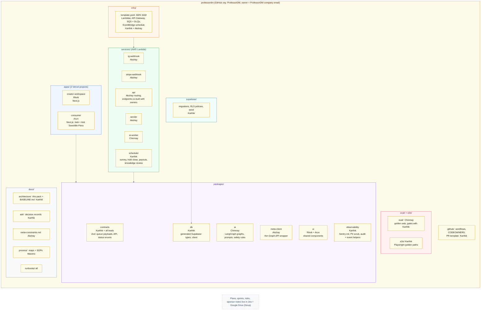

---

## 13 — Creator Onboarding Sequence

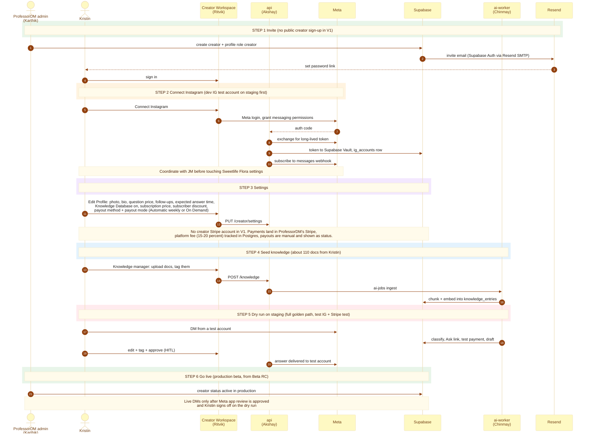

---
